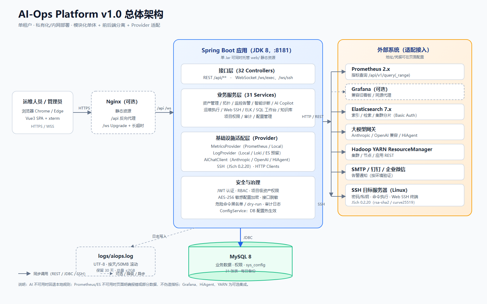
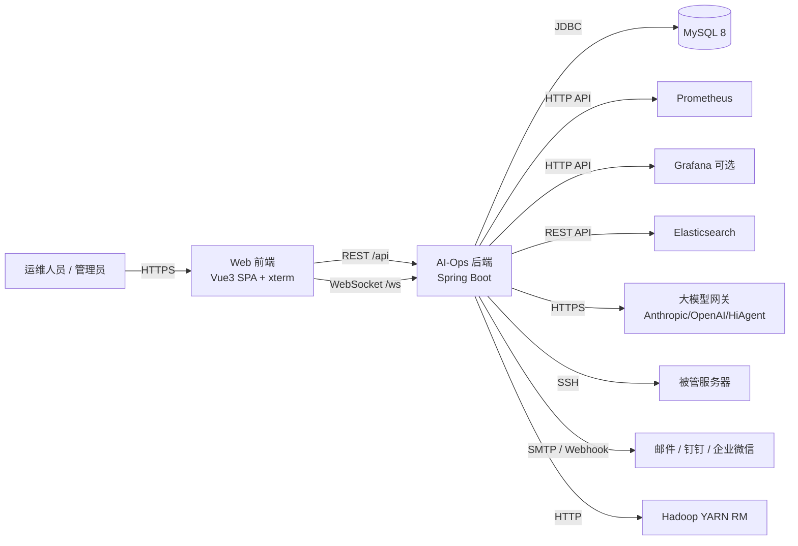
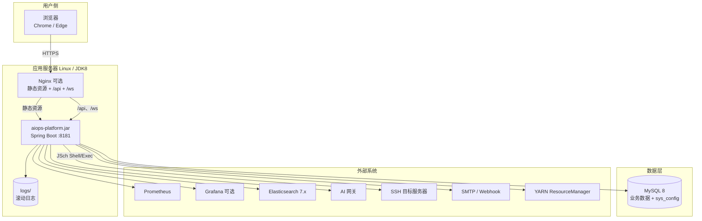
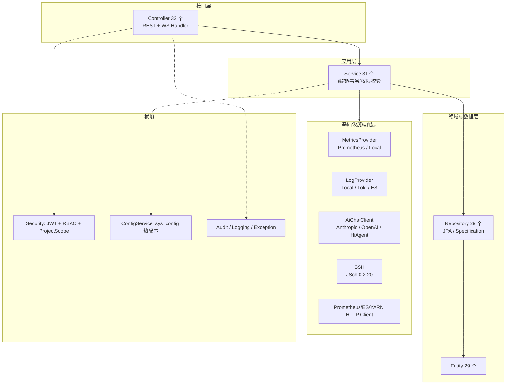
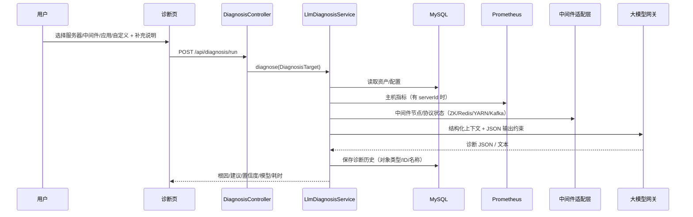
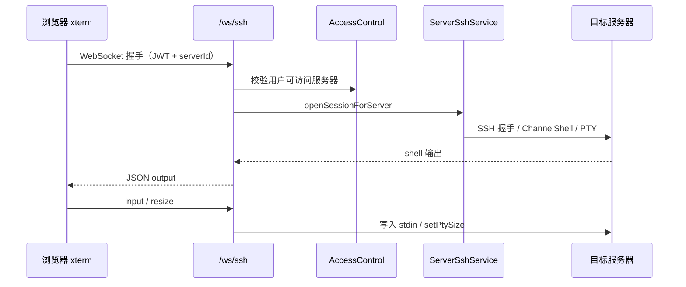
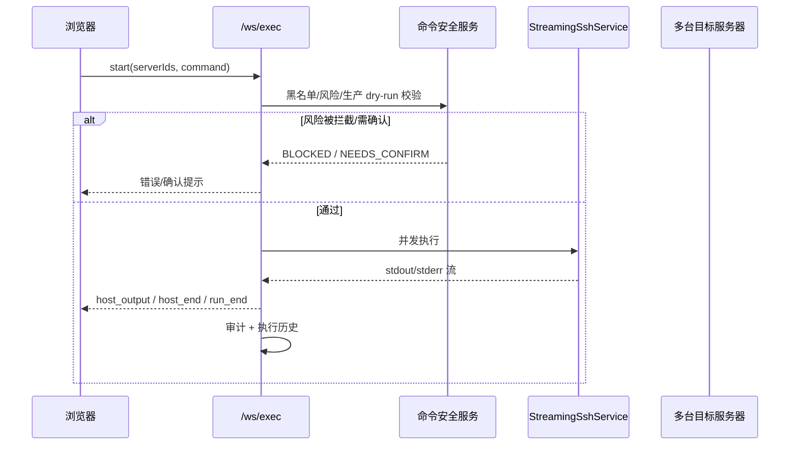
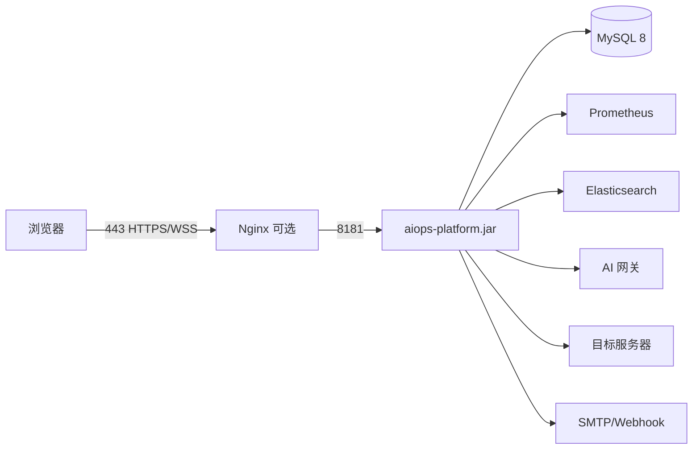

# AI-Ops Platform v1.0 技术方案与架构设计说明

| 项目   | 内容                      |
| ---- | ----------------------- |
| 文档版本 | v1.0（2026-10-27）        |
| 产品版本 | AI-Ops Platform 1.0.0   |
| 文档用途 | 产品上架、技术评审、客户方案、部署交付     |
| 适用范围 | 单租户、私有化/内网部署的 AI 增强运维平台 |
| 目标读者 | 产品、研发、架构、运维、安全、售前/交付    |

---

## 0. 摘要

AI-Ops Platform 是面向内网/私有化环境的“一体化智能运维平台”，把 **CMDB 资产、监控告警、智能诊断、AI Copilot、命令执行/Web SSH、日志与 ELK、SQL 工作台、知识库、审计**整合在一个产品中。

v1.0 的架构定位是：

> **模块化单体 + 前后端分离 + 可单 Jar 交付 + 外部系统适配层**。

核心特点：

- 单 Jar + 静态前端即可交付，适合离线/内网环境；
- 以资产为中心，把服务器、中间件、应用、项目、拓扑统一建模；
- AI 能力可插拔：支持 Anthropic/OpenAI 兼容网关/HiAgent，失败自动回退本地规则；
- 敏感信息 AES 加密存储，接口不回显；
- Prometheus / Elasticsearch / SSH / SMTP 等外部系统通过适配层接入；
- 所有高风险操作有审计记录，批量命令有黑名单/dry-run 机制。

当前代码规模（v1.0）：

| 指标                      | 数量                                      |
| ----------------------- | --------------------------------------- |
| 后端 Controller / Service | 32 / 31                                 |
| 实体 / Repository         | 29 / 29                                 |
| 数据库表                    | 31                                      |
| 前端页面（Vue）               | 25                                      |
| Java 代码行                | 约 16,100                                |
| 前端 TS/Vue 代码行           | 约 9,400                                 |
| 构建产物                    | 后端 Jar 约 53 MB，前端静态包约 0.75 MB（gzip 后更小） |

---

## 1. 产品定位与版本范围

### 1.1 目标客户

- 50～500 台服务器规模的内网运维团队；
- 有 Prometheus、Elasticsearch、Kafka/ZooKeeper/Redis/MySQL/Hadoop 等基础设施；
- 希望把“看监控、查日志、登录机器、执行命令、问 AI、写 SQL、查知识库”收敛到一个平台；
- 对外网依赖低、要求私有化部署、数据不出内网。

### 1.2 v1.0 核心价值

1. **资产与拓扑统一**：服务器/中间件/应用/项目/关系一张图；
2. **监控告警一体化**：Prometheus 原生查询、告警规则/历史、通知；
3. **AI 诊断与 Copilot**：基于真实资产、指标、日志、中间件节点状态做分析和建议；
4. **运维执行闭环**：批量命令、实时流式输出、危险命令管控、Web SSH 交互式终端；
5. **数据工具链**：ELK 索引/检索/集群分片、SQL 工作台（连接由数据库资产同步）；
6. **运维知识沉淀**：知识库 + RAG，Copilot 可引用内部资料；
7. **可交付性**：JDK8、MySQL、单 Jar、离线部署、日志轮转、审计。

### 1.3 v1.0 范围

**包含**：

- 登录/JWT/RBAC/菜单/项目级资产权限/审计；
- 服务器、中间件（数据库/Kafka/ZK/Redis/Hadoop 等）、应用、项目、拓扑；
- 监控面板、仪表盘、告警规则/历史、通知；
- 智能诊断（服务器/中间件/应用/自定义）；
- AI Copilot（对话、方案、代码块、执行、页面跳转、知识库 RAG）；
- 批量命令执行、WebSocket 实时输出、Web SSH 交互终端、定时任务；
- ELK 连接/索引/检索/集群分片；
- SQL 工作台（MySQL/PostgreSQL/Greenplum/GBase/Oracle/达梦）；
- 知识库导入/检索；
- 系统设置（AI、数据源、邮件、日志源、安全配置）。

**不包含（v1.0 明确边界）**：

- 多租户 SaaS、计费、License 授权；
- SSO/OIDC/LDAP/MFA；
- 高可用集群、跨机房容灾；
- 全量日志采集代理（Loki/ES 日志源适配未完成，当前以本地日志表和 ELK 页面为主）；
- Kafka AdminClient 级别的 Topic/消费组管理（当前 Kafka 详情为 Broker 节点 TCP 连通性）；
- 移动端、Windows 目标主机管理（SSH 以 Linux 为主）；
- 完整 APM/调用链追踪。

---

## 2. 总体架构

### 2.1 架构原则

1. **先解决交付，再解决拆分**：内网/离线场景优先单 Jar、低依赖、可运维；
2. **资产为中心**：监控、诊断、执行、SQL、拓扑都围绕统一资产模型；
3. **适配层隔离外部系统**：Prometheus/ES/AI/SSH/日志源均通过 Provider/Client 抽象；
4. **运行时配置优先**：可变的业务配置进数据库，yml 只保留启动默认值；
5. **安全默认开启**：认证、项目权限、敏感字段加密、审计、危险命令管控；
6. **AI 可降级**：大模型不可用时必须有本地规则/明确提示，不让核心流程失效；
7. **可观测**：运行日志、审计日志、Actuator 指标、健康检查可被外部采集。

### 2.1.1 总体架构图（交付版）



> 可编辑源文件：`docs/architecture-v1.0.svg`；下文 2.2～2.4 提供 Mermaid 版本，便于在 Markdown 中维护。

### 2.2 系统上下文图



### 2.3 容器与部署图



> 也支持“无 Nginx”模式：`springBoot.sh` 检测到 `web/index.html` 后，由后端直接托管前端静态资源，浏览器同源访问 `:8181`。

### 2.4 后端分层



### 2.5 关键业务流程

#### 2.5.1 智能诊断



#### 2.5.2 Web SSH 终端



#### 2.5.3 批量命令执行



---

## 3. 技术栈

### 3.1 后端

| 类别       | 技术                                | 版本              | 用途                             |
| -------- | --------------------------------- | --------------- | ------------------------------ |
| 语言/运行时   | Java                              | 1.8             | 兼容客户存量 JDK8 环境                 |
| 框架       | Spring Boot                       | 2.7.18          | Web、依赖注入、自动配置                  |
| 安全       | Spring Security + JJWT            | 5.7 / 0.11.5    | 认证、JWT 签发校验                    |
| 数据访问     | Spring Data JPA + Hibernate       | 随 Boot 2.7      | ORM、Specification 查询           |
| 数据库      | MySQL                             | 8.x（连接器 8.0.33） | 系统记录；H2 2.1.214 作为离线备用         |
| 缓存       | Caffeine                          | 随 Boot          | 本地缓存（max 10000 / 1h）           |
| 实时       | Spring WebSocket                  | 随 Boot          | 命令流、Web SSH                    |
| SSH      | JSch（mwiede 分支，包名兼容）              | 0.2.20          | 现代 SSH 算法（rsa-sha2、curve25519） |
| HTTP 客户端 | RestTemplate + Apache HttpClient5 | 5.3             | Prometheus/ES/AI/YARN 调用       |
| 验证       | Bean Validation                   | 随 Boot          | 入参校验                           |
| 可观测      | Spring Boot Actuator              | 随 Boot          | health/info/prometheus         |
| 构建       | Maven                             | 3.6+            | 打包                             |
| 辅助       | Lombok、Jackson                    | 随 Boot          | 简化代码、JSON                      |

### 3.2 前端

| 类别       | 技术                    | 版本         | 用途               |
| -------- | --------------------- | ---------- | ---------------- |
| 框架       | Vue                   | 3.4        | SPA              |
| 构建       | Vite                  | 5.2        | 开发/构建/preview    |
| 语言       | TypeScript            | 5.4        | 类型安全             |
| UI       | Element Plus          | 2.7        | 组件库              |
| 状态       | Pinia                 | 2.1        | 用户/拓扑/Copilot 状态 |
| 路由       | Vue Router            | 4.3        | 动态菜单路由           |
| 请求       | Axios                 | 1.7        | REST 封装、JWT 注入   |
| 图表       | ECharts + vue-echarts | 5.5 / 6.6  | 仪表盘、拓扑、监控        |
| 终端       | xterm + addon-fit     | 5.5 / 0.10 | Web SSH          |
| 内容安全     | DOMPurify             | 3.4        | 日志/富文本清洗         |
| Markdown | marked                | 18.1       | Copilot 内容展示     |
| 样式       | Sass                  | 1.77       | 主题与布局            |

### 3.3 外部系统

| 系统            | 接入方式                          | 说明                                         |
| ------------- | ----------------------------- | ------------------------------------------ |
| Prometheus    | `/api/v1/query`、`query_range` | 指标源可页面配置、热生效                               |
| Grafana       | 同源代理（可选）                      | 兼容旧看板，非核心依赖                                |
| Elasticsearch | REST（Basic Auth）              | ELK 索引/检索/集群分片                             |
| 大模型           | Anthropic/OpenAI 兼容/HiAgent   | 统一 `AiChatClient`，配置热切换                    |
| 被管服务器         | SSH                           | 密码或私钥；批量命令/Web 终端                          |
| Hadoop        | YARN RM REST                  | 集群/节点/应用                                   |
| 通知            | SMTP、Webhook 配置               | 邮件为主，Webhook 按环境验证                         |
| 数据库工作台        | JDBC                          | MySQL/PostgreSQL/Greenplum/GBase/Oracle/达梦 |

---

## 4. 架构选型说明与备选方案对比

### 4.1 后端形态：模块化单体（已采纳）

| 方案            | 优势                             | 劣势                                 | 适用性              |
| ------------- | ------------------------------ | ---------------------------------- | ---------------- |
| **模块化单体（现选）** | 单 Jar 交付、部署简单、事务简单、调试成本低；适合私有化 | 单点扩容、模块边界依赖纪律、发布粒度粗                | v1.0 目标客户规模与离线交付 |
| 微服务           | 独立扩容/发布、故障隔离                   | 运维复杂、服务治理/链路/配置中心成本高；客户内网难维护       | 多租户 SaaS/大规模团队   |
| Node/NestJS   | 前后端同语言、生态活跃                    | 运维/SQL/SSH/批处理生态弱于 Java；客户环境多为 JDK | 不匹配              |
| Python/Django | AI/脚本生态好、开发快                   | 长连接/并发/企业 Java 运维体系适配弱             | AI 原型可行，产品化弱     |

**结论**：v1.0 采用模块化单体；通过 `controller/service/repository/infrastructure` 分层和 Provider 接口保留拆分可能。触发拆分条件：单实例 CPU/内存持续 >70%、模块发布节奏严重冲突、需要多租户独立扩容。

### 4.2 运行时：Java 8 + Spring Boot 2.7（已采纳，带技术债）

| 方案                        | 优势                    | 劣势                                |
| ------------------------- | --------------------- | --------------------------------- |
| **Java 8 + Boot 2.7（现选）** | 客户存量 JDK8、离线环境兼容、依赖成熟 | Boot 2.7 OSS 支持已结束；无法使用虚拟线程、新安全特性 |
| Java 17 + Boot 3.2+       | 长期支持、性能/安全更好、可观测生态新   | 需要客户升级 JDK、部分依赖升级、迁移成本            |
| Java 11 + Boot 2.7        | 折中，仍可使用旧生态            | 仍受 Boot 2.7 EOL 限制                |

**结论**：v1.0 保持 Java 8 以降低交付阻力；v2.0 规划升级 Java 17 + Boot 3.x。升级需同步 JJWT、JSch、Hibernate 等依赖。

### 4.3 前端：Vue 3 + Vite + Element Plus（已采纳）

| 方案                             | 优势                     | 劣势                                     |
| ------------------------------ | ---------------------- | -------------------------------------- |
| **Vue3/Vite/Element Plus（现选）** | 国内生态成熟、组件完整、开发效率高、体积可控 | 主包偏大（当前主 chunk 约 1.26 MB）；复杂表格/终端需额外优化 |
| React + Ant Design             | 生态大、招聘容易               | 团队技术栈/组件风格迁移成本                         |
| 低代码平台                          | 快速搭页面                  | 复杂交互（拓扑、终端、大屏）受限                       |

**结论**：保持 Vue3；后续做路由级懒加载、ECharts 按需引入、manualChunks 拆分。

### 4.4 数据库：MySQL 为系统记录（已采纳）

| 方案              | 优势                            | 劣势                     |
| --------------- | ----------------------------- | ---------------------- |
| **MySQL 8（现选）** | 客户常见、运维熟悉、JSON/TEXT 够用、备份工具成熟 | 复杂分析/窗口函数弱于 PG；大表治理需规范 |
| PostgreSQL      | 功能强、扩展性好、JSONB                | 客户存量少、交付运维成本高          |
| H2 文件库          | 零依赖、离线演示方便                    | 并发/容量/备份不适合生产          |

**结论**：生产统一 MySQL；H2 仅保留离线/演示 profile，不作为生产推荐。

### 4.5 认证授权：JWT + RBAC + 项目范围（已采纳）

| 方案                                 | 优势               | 劣势                       |
| ---------------------------------- | ---------------- | ------------------------ |
| **JWT + RBAC + project_asset（现选）** | 无状态、部署简单、前后端分离友好 | 令牌撤销/单点注销弱；需额外实现 MFA/SSO |
| Session + Redis                    | 易撤销、适合传统单体       | 需要 Redis/会话共享，增加组件       |
| Keycloak/OIDC                      | 企业级 SSO/MFA/审计   | 交付复杂、客户需额外维护 IdP         |

**结论**：v1.0 保持 JWT；企业版增加 OIDC/LDAP/MFA，JWT 保留为内部令牌。

### 4.6 AI 接入：Provider 抽象 + 规则回退（已采纳）

| 方案                           | 优势                                   | 劣势                |
| ---------------------------- | ------------------------------------ | ----------------- |
| **统一 AiChatClient + 工厂（现选）** | 支持 Anthropic/OpenAI/HiAgent 热切换；无强依赖 | 需自行维护提示词/解析/降级    |
| 直接调用某厂商 SDK                  | 简单                                   | 锁定厂商、切换成本高        |
| LangChain/LlamaIndex         | 组件丰富、RAG 快                           | 依赖重、版本变化快、内网离线维护难 |


**结论**：自建轻量抽象，RAG 用自有知识库检索（kb_chunk），不引入 LangChain。

### 4.7 实时通道：WebSocket（已采纳）

| 方案 | 优势 | 劣势 |
| --- | --- | --- |
| **WebSocket（现选）** | 双向、适合终端/命令流/长会话 | 需要连接管理、代理 Upgrade、粘性会话 |
| SSE | 简单、单向推送 | 无法承载键盘输入/双向终端 |
| 轮询 | 实现最简单 | 延迟高、请求量大，不适合交互终端 |

**结论**：命令执行与 Web SSH 必须 WebSocket；Nginx 需配置 Upgrade 与长超时。

### 4.8 SSH：JSch（mwiede 0.2.20，已采纳）

| 方案 | 优势 | 劣势 |
| --- | --- | --- |
| **JSch mwiede（现选）** | 包名兼容、支持现代算法、集成成本低 | 库维护依赖社区；无连接池/审计中间件 |
| Apache MINA SSHD | Apache 生态、功能全 | 依赖更大、迁移成本 |
| 外部堡垒机/网关 | 安全审计更强 | 增加部署组件和网络改造 |

**结论**：v1.0 直连 SSH；企业版可接堡垒机/网关，平台只做编排与审计。

### 4.9 监控：直连 Prometheus（已采纳）

| 方案 | 优势 | 劣势 |
| --- | --- | --- |
| **Prometheus HTTP API（现选）** | 不复制指标、部署轻、客户已有 Prometheus 直接复用 | 强依赖外部 Prometheus；无长期存储/降采样 |
| 内嵌 TSDB | 自主可控 | 存储/运维成本高，重复造轮子 |
| 嵌入 Grafana | 图表丰富 | 登录/权限/iframe 集成复杂，已有代理仅兼容 |

**结论**：监控面板原生实现；Grafana 作为可选兼容。

### 4.10 日志/ELK：REST 代理（已采纳）

| 方案 | 优势 | 劣势 |
| --- | --- | --- |
| **ES REST + 自研页面（现选）** | 与平台权限/审计统一、可做集群分片页 | 功能不如 Kibana 全；大结果集需分页/限制 |
| 嵌入 Kibana | 功能强 | 认证/iframe/跨域复杂，客户版本差异大 |
| Loki 自建 | 轻量 | 需要额外部署与日志采集代理 |

**结论**：v1.0 以 ES 管理/检索为主；日志源 Provider 已预留 Loki/ES，但完整日志采集接入在后续版本。

### 4.11 部署形态：Jar + 静态资源（已采纳）

| 方案 | 优势 | 劣势 |
| --- | --- | --- |
| **Jar + web（现选）** | 离线简单、单进程、客户易接受 | 扩缩容粗、无编排、升级需停服 |
| Docker Compose | 环境一致、交付标准化 | 客户内网可能无 Docker/镜像仓库 |
| Kubernetes | 弹性/自愈/滚动升级 | 运维门槛高，v1.0 过度设计 |

**结论**：标准版 Jar + web；企业版提供 Docker/K8s Helm Chart。

---

## 5. 架构决策记录（ADR）

### ADR-001 采用模块化单体而非微服务

- **状态**：已采纳
- **背景**：v1.0 面向私有化/内网，客户运维能力有限；功能模块共享资产、权限、配置、审计。
- **决策**：单一 Spring Boot 应用，按 controller/service/repository/infrastructure 分层；模块内高内聚，模块间通过 Service 接口。
- **后果**：交付简单、事务简单；需要代码评审守住边界；扩容以垂直/多实例+粘性会话为主。
- **复审条件**：单实例资源持续瓶颈、模块独立发布需求明确、SaaS 多租户。

### ADR-002 Java 8 + Spring Boot 2.7

- **状态**：已采纳（技术债）
- **背景**：客户环境普遍 JDK8；交付包需要离线运行。
- **决策**：锁定 Java 8 + Boot 2.7.18；依赖版本以 Java8 兼容为准。
- **后果**：可使用存量 JDK；但 Boot 2.7 OSS 已 EOL，安全补丁需自行评估；无法使用新特性。
- **复审条件**：v2.0 或客户 JDK 升级；出现无法规避的安全漏洞。

### ADR-003 前后端分离，但支持单 Jar 托管

- **状态**：已采纳
- **背景**：客户可能没有 Nginx，也可能已有统一 Nginx/网关。
- **决策**：前端独立构建为 `web/`；`springBoot.sh` 检测到 web 后由后端托管；也支持 Nginx 反向代理。
- **后果**：交付灵活；后端需处理 SPA history 回退与静态缓存；WebSocket 代理需正确配置。
- **复审条件**：CDN/多前端版本并行、静态资源独立发布。

### ADR-004 MySQL 为系统记录，sys_config 承担运行时配置

- **状态**：已采纳
- **背景**：AI 地址/Key、Prometheus 地址、日志源等需页面修改且不想重启。
- **决策**：业务数据和运行配置统一入库；`ConfigService` 内存缓存 + DB 持久化；优先级 DB > yml > 代码默认。
- **后果**：配置热生效、便于迁移；数据库成为关键依赖；需要备份与权限控制。
- **复审条件**：配置规模/多环境管理复杂化，考虑配置中心。

### ADR-005 JWT + RBAC + 项目级资产权限

- **状态**：已采纳
- **背景**：前后端分离、无状态部署；需要按项目隔离资产。
- **决策**：JWT Bearer 令牌，24h 过期；角色/菜单 + `project_asset`/`project_role` 控制资产可见性；服务端 `AccessControlService` 校验。
- **后果**：部署简单；令牌撤销、MFA、SSO 需后续补齐；菜单权限与接口权限需持续对齐。
- **复审条件**：企业 SSO 需求、合规要求。

### ADR-006 敏感配置 AES 加密 + 环境主密钥

- **状态**：已采纳
- **背景**：AI Key、SSH/DB/ELK 密码不能明文入库/回显。
- **决策**：`PasswordEncryptor` 使用 AES-256-CBC（SHA-256 派生密钥、随机 IV）；密文入库；接口不回显；主密钥来自 `AES_KEY` 环境变量；启动迁移历史明文。
- **后果**：降低泄露面；主密钥丢失/更换会导致旧密文不可解，需要备份与轮换流程；默认密钥必须替换。
- **复审条件**：引入 KMS/Vault、密钥轮换平台化。

### ADR-007 AI 能力 Provider 化 + 规则回退

- **状态**：已采纳
- **背景**：客户 AI 网关差异大（Anthropic/OpenAI/HiAgent），且可能不可用。
- **决策**：`AIClientFactory` 运行时构建客户端；`DiagnosisService`/`AISolutionTemplateService` 在失败时回退规则；AI Key 加密存 DB。
- **后果**：避免厂商锁定；规则答案质量有限；提示词/JSON 解析需要持续治理。
- **复审条件**：引入多模型路由、成本/质量评估、Agent 工具调用。

### ADR-008 WebSocket + JSch 实现命令流与 Web SSH

- **状态**：已采纳
- **背景**：需要实时输出和交互式 shell，且不引入额外堡垒机。
- **决策**：`/ws/exec` 流式批量执行；`/ws/ssh` ChannelShell + PTY；握手校验 JWT，按项目权限控制服务器；审计会话。
- **后果**：体验接近 Xshell；WebSocket 需粘性会话/代理配置；交互终端绕过命令安全校验，属于显式风险。
- **复审条件**：引入堡垒机/会话录像、细粒度命令审计。

### ADR-009 Prometheus 直连，不内嵌时序库

- **状态**：已采纳
- **背景**：客户已有 Prometheus；重复存储成本高。
- **决策**：后端按需查询 Prometheus HTTP API；指标源/地址页面可配；Prometheus 不可用时明确报错/空数据，不伪造。
- **后果**：轻量；依赖外部系统；大范围查询需限制时间窗/并发；无长期存储。
- **复审条件**：需要跨集群长期指标、SLA 要求高，考虑 VictoriaMetrics/Thanos。

### ADR-010 ELK 通过 REST 集成，自研管理页面

- **状态**：已采纳
- **背景**：客户 ES 版本/认证差异大，Kibana 嵌入认证复杂。
- **决策**：Basic Auth + REST API；提供索引、日志检索、集群健康/分片页面。
- **后果**：权限统一、页面风格统一；检索能力不如 Kibana；大集群需分页/索引过滤。
- **复审条件**：需要复杂可视化/Discover 能力，可增加 Kibana 跳转。

### ADR-011 数据库结构由 schema.sql 自动补齐（技术债）

- **状态**：已采纳（待替换）
- **背景**：早期快速交付；MySQL 每次启动执行 `schema.sql`，`continue-on-error` 忽略重复列/索引。
- **决策**：`CREATE TABLE IF NOT EXISTS` + `ALTER TABLE ADD COLUMN`；升级时自动补列。
- **后果**：升级简单；DDL 无版本记录、不可回滚、重复错误噪声；复杂变更风险高。
- **复审条件**：v1.1 引入 Flyway/Liquibase，采用 expand-contract 迁移。

### ADR-012 v1.0 单租户，按客户独立部署

- **状态**：已采纳（产品化约束）
- **背景**：客户内网隔离、数据敏感；多租户改造成本高。
- **决策**：一套部署一套数据库，服务一个客户/团队；不做租户字段隔离。
- **后果**：隔离清晰、实现简单；无法 SaaS 化；升级/运维按客户实例进行。
- **复审条件**：SaaS 或集团多租户需求明确，启动 tenant_id + 行级隔离改造。

### ADR-013 菜单/数据迁移由 SQL 脚本 + data.sql 管理（技术债）

- **状态**：已采纳
- **背景**：菜单是数据库数据，不能随 schema.sql 自动插入，避免覆盖客户自定义。
- **决策**：新库用 data.sql；存量库使用 `scripts/migrate/*.sql` 手动执行；启动不自动改菜单。
- **后果**：升级步骤多一步 SQL；需交付文档与校验脚本；后续可用版本化迁移工具统一。
- **复审条件**：Flyway 接管菜单迁移，提供自动升级。

### ADR-014 以资产为中心的数据模型

- **状态**：已采纳
- **背景**：监控、诊断、执行、SQL、拓扑都需要统一的服务器/中间件/应用/项目视图。
- **决策**：server/middleware/app/project/asset_relation 为核心；SQL 连接由数据库类资产同步；中间件详情按类型扩展。
- **后果**：数据一致、权限统一；资产模型变更影响面大；需维护同步/迁移规则。
- **复审条件**：引入自动发现（CMDB 同步/服务目录）后，需定义资产主数据源。

---

## 6. 功能需求

### 6.1 角色

| 角色 | 权限 |
| --- | --- |
| ROLE_ADMIN | 系统管理、资产管理、执行、配置、全部项目 |
| ROLE_USER | 基础访问；按项目/角色可见资产与操作 |
| 只读/审计（规划） | 查看监控、日志、审计，不可执行变更 |
| AI/自动化账户（规划） | 仅 API/任务，最小权限 |

### 6.2 功能矩阵

| 模块 | 核心功能 | v1.0 验收要点 |
| --- | --- | --- |
| 认证与权限 | 登录、JWT、角色/菜单、项目资产权限 | 未登录 401；越权资产不可见/不可操作 |
| 资产管理 | 服务器/中间件/应用/项目 CRUD；导入、Prometheus 同步、复制、SSH 测试/自动探测 | 资产可维护、凭据加密、SSH 用户可见 |
| 拓扑 | 应用-中间件-服务器关系；自动推导；可视化编辑；表格维护 | 拖拽/点击连线、方向/重复校验、边编辑/删除 |
| 监控 | 仪表盘、原生监控面板、Prometheus 指标源 | 指标真实、数据源可配、异常明确 |
| 告警 | 规则、历史、阈值、邮件/Webhook 通知 | 规则生效、历史可查、通知可配（按环境验证） |
| 智能诊断 | 服务器/中间件/应用/自定义；LLM + 规则回退；历史 | 上下文引用真实数据；失败可降级；对象可追溯 |
| AI Copilot | 对话、结构化方案、代码块、执行、页面跳转、知识库 RAG | 资产上下文正确；危险执行二次确认 |
| 批量执行 | 多机命令、流式输出、终止、dry-run、黑名单、历史 | 危险命令拦截/确认；输出实时；审计完整 |
| Web SSH | 交互式 shell、PTY、缩放、全屏、审计 | 凭据校验、权限校验、断线清理 |
| 定时任务 | Cron 任务、执行历史 | 任务可管理、结果可查 |
| 日志 | 本地日志查询（ELK 页面另行） | 当前默认本地表；Loki/ES 日志源待完善 |
| ELK | 连接、索引、检索、集群健康/分片 | ES 7.x 兼容、认证、错误降级 |
| SQL 工作台 | 资产同步连接、库/表/字段、查询、历史、危险 SQL 检查 | 连接只来自数据库资产；账号密码加密 |
| 中间件详情 | Kafka/ZooKeeper/Redis/Hadoop YARN 节点/协议状态 | 节点连通、状态可读、控制台跳转 |
| 知识库 | 导入、切分、检索、RAG | 文档可检索；Copilot 可引用 |
| 审计 | 操作/执行/终端会话审计 | 可检索、不可篡改（建议后续 append-only） |
| 系统设置 | AI、数据源、邮件、日志源、密钥配置 | 保存即生效；敏感项不回显 |

### 6.3 非功能相关的功能约束

- 所有写操作需登录 + 角色/项目校验；
- 敏感字段只写不读；
- 批量执行/Web SSH 必须审计；
- AI 输出不得直接执行，需用户确认；
- 外部系统不可用时，页面必须给出明确错误或降级结果，不得静默伪造数据。

---

## 7. 非功能需求

> 以下“目标值”为 v1.0 产品验收建议；“现状”为当前代码/部署实际能力，正式上架前应完成压测与安全加固。

### 7.1 性能

**参考规模（标准版）**：≤500 台服务器、≤2,000 个中间件/应用、≤50 并发用户、≤100 个 WebSocket 会话、Prometheus ≤20,000 series。

| 指标 | 目标 | 现状/说明 |
| --- | --- | --- |
| 登录响应 | P95 < 1s | 当前通常 < 200ms（本地） |
| 列表/CRUD | P95 < 500ms | 依赖索引与数据量；部分历史查询未分页 |
| 仪表盘/监控 | P95 < 3s | Prometheus 查询窗口与并发需限制 |
| 智能诊断 | P95 < 30s | 实测中间件约 10-11s，自定义约 15s（外部模型） |
| Web SSH 回显 | 局域网 P95 < 200ms | 依赖 SSH 网络与目标负载 |
| 命令流首包 | < 1s | 并发主机数需限制（当前单次 ≤50） |
| SQL 查询 | 500 行 < 3s | 受目标库影响；当前默认限制 500 行 |
| 首屏加载 | < 2s（内网） | 主包约 1.26MB，需后续拆包 |

**优化建议**：

- 对 server_asset/middleware_asset/app_asset/alert_history/audit 等大表补充复合索引；
- 为诊断历史、告警历史、审计日志增加分页与时间范围过滤；
- WebSocket 输出做批量合并，避免高频小包；
- 前端路由懒加载、ECharts 按需引入、manualChunks；
- 增加限流/并发上限（AI、Prometheus、SSH、ES）；
- 使用 JMeter/k6 做基线压测，记录 P50/P95/P99。

### 7.2 可用性

| 项目 | 目标/约束 |
| --- | --- |
| 标准版 SLA | 工作时间 99.5%（单实例，计划内维护除外） |
| 部署形态 | 单应用实例 + MySQL；可选 Nginx |
| 故障域 | 应用、MySQL、外部 Prometheus/ES/AI/SSH 均可能成为单点 |
| RTO/RPO | 建议 RTO ≤ 60 分钟，RPO ≤ 24 小时（每日备份；如需更低 RPO 开启 binlog） |
| 降级 | AI 不可用→规则引擎；Prometheus/ES 不可用→明确错误/部分数据；SSH 独立 |
| 升级 | 停服升级，jar+web 替换；需回滚包与数据库备份 |

**注意**：

- WebSocket 会话、定时任务、内存状态都在单实例；多实例需粘性会话 + 任务选主。
- Web SSH/命令执行在应用重启时会中断，需要前端提示重连。
- 建议企业版提供双实例 + 负载均衡 + 共享 MySQL 的高可用方案。

### 7.3 安全

**已实现**：

- JWT 认证（24h）、BCrypt 密码、RBAC 菜单/角色、项目级资产访问控制；
- AES-256-CBC 加密敏感字段（AI Key、SSH/DB/ELK 密码）；接口不回显；
- 批量命令黑名单、风险等级、生产 dry-run、审计；
- Web SSH 仅允许有权限的服务器，会话审计，页面安全提示；
- 文件上传大小限制（单文件 50MB/请求 200MB）；
- 审计日志、执行历史、诊断历史。

**上架前必须补齐（P0）**：

1. 强制修改默认 `admin/123456`；首次初始化向导；
2. 替换默认 JWT secret 与默认 AES_KEY，并提供密钥备份/轮换说明；
3. 全站 HTTPS（WebSocket 使用 WSS），禁止明文传输；
4. 登录失败锁定/验证码/速率限制；接口限流；
5. 菜单权限与后端接口权限逐一核对（不能只依赖前端隐藏）；
6. 关闭 H2 Console（生产已关闭）、限制 CORS 白名单；
7. 数据库最小权限账号；SSH 最小权限账号；
8. 依赖漏洞扫描（OWASP Dependency-Check/Trivy）；
9. AI 提示词注入与输出校验；禁止 AI 输出直接执行；
10. 备份加密与恢复演练。

**风险提示**：

- Web SSH 绕过命令安全校验，属于“受控高风险功能”，仅授予可信管理员；
- ELK/YARN 的自定义 URL 属于服务端请求（SSRF 面），需限制内网白名单；
- 交互终端与 AI 都可能泄露敏感信息，需要网络与权限边界。

### 7.4 可观测性

| 维度 | 现状 | 建议 |
| --- | --- | --- |
| 日志 | `logs/aiops.log`，UTF-8，按天/50MB 滚动，保留 30 天/2GB | 增加 traceId、JSON 结构化、集中采集（Loki/ES） |
| 指标 | Actuator `/actuator/prometheus`，JVM/HTTP 基础指标 | 增加业务指标（诊断耗时、AI 失败率、SSH 会话数） |
| 健康 | `/actuator/health`、`/api/system/health` | 接入外部监控与自告警 |
| 审计 | sys_audit_log、exec_log、诊断历史 | 定义保留期、不可篡改存储、导出 |
| 追踪 | 无 | 引入 OpenTelemetry（HTTP/DB/AI/SSH 调用） |
| 面板 | 产品自身监控页 | 增加“平台自身健康”页 |

### 7.5 成本

**私有化标准版 BOM（参考）**：

| 资源 | 建议规格 | 说明 |
| --- | --- | --- |
| 应用服务器 | 8C / 16GB / 200GB | 单实例 + 日志 |
| MySQL | 4C / 8GB / 100GB | 独立或复用客户实例 |
| 备份存储 | 200GB+ | 每日全量 + 保留策略 |
| 可选 Nginx | 2C / 2GB | 静态资源 + WS 代理 |
| 外部依赖 | Prometheus/ES/LLM 网关 | 复用客户现有资源 |

**成本构成**：

- 软件：开源组件，无商业 License（v1.0）；
- AI：按 token 计费/内网网关成本；诊断/对话频率决定；
- 运维：升级、备份、日志、权限、故障处理；
- 可选：Grafana/ES/堡垒机/硬件。

**优化方向**：诊断上下文裁剪、缓存资产/配置、AI 调用限流与超时、按需加载前端资源。

### 7.6 兼容性

| 项目 | 支持 |
| --- | --- |
| 操作系统 | Linux x86_64（生产）；Windows 仅开发/本地 |
| 运行时 | JDK 8（当前）；规划 JDK17 |
| 数据库 | MySQL 8.x；H2 2.1.214 仅离线/演示 |
| 浏览器 | Chrome / Edge 现代版本（WebSocket、Canvas、ES2020） |
| Elasticsearch | 7.x（实测 7.17.5）；8.x 需回归 |
| Prometheus | 2.x HTTP API |
| SSH | 支持 rsa-sha2/curve25519（mwiede JSch 0.2.20）；目标 Linux |
| AI | Anthropic 兼容、OpenAI 兼容、HiAgent |
| 终端 | xterm.js，需 WebSocket/WSS |

### 7.7 部署约束

- 内网/离线：构建机准备依赖，服务器无需外网；
- 单 Jar + web + 外置 `application.yml`；JDK8；
- 必须能访问：MySQL；按需访问 Prometheus/ES/AI/SSH/YARN/SMTP；
- 端口：8181（应用）、3306（MySQL）、9090（Prometheus）、9200（ES）、22（SSH）、443（HTTPS）；
- `AES_KEY` 必须持久化且不可随意更换；
- 数据库升级由 jar 内 `schema.sql` 自动补表/列；菜单变更需执行 `scripts/migrate/*.sql` 并重新登录；
- Nginx 代理必须支持 `/ws` Upgrade 与长连接超时；
- 日志磁盘需预留 ≥2GB，开启轮转；
- 备份：MySQL 每日全量 + 关键配置/AES_KEY 离线备份。

---

## 8. 数据架构

### 8.1 领域分组（31 张表）

| 领域 | 表 |
| --- | --- |
| 身份/权限 | sys_user、sys_role、sys_menu、sys_user_role、sys_role_menu |
| 资产 | server_asset、middleware_asset、app_asset、project、project_asset、project_role、asset_relation |
| 监控/告警 | alert_rule、alert_history、sys_log_simulate |
| AI | ai_chat_session、ai_chat_message、ai_solution_template、ai_diagnosis_history |
| 执行 | exec_log、exec_run、exec_run_host |
| 数据库/ES | db_connection、db_execute_log、elk_connection |
| 知识库 | kb_knowledge_base、kb_document、kb_chunk |
| 治理 | sys_config、sys_audit_log |


### 8.2 关键设计

- 资产统一 ID 与类型枚举（SERVER/MIDDLEWARE/APP），拓扑关系使用 `asset_relation`；
- 项目与资产多对多（project_asset），权限按项目收敛；
- SQL 工作台连接由数据库类中间件资产同步，密码加密；
- 诊断历史保存目标类型/ID/名称 + 输入上下文摘要 + 结果；
- 敏感字段：SSH 密码、DB/ELK 密码、AI Key、HiAgent 凭据均加密；
- 大字段：TEXT 存放 JSON 列表、日志上下文、AI 输入摘要；需控制长度。

### 8.3 数据保留与备份（建议）

| 数据 | 建议保留 | 当前 |
| --- | --- | --- |
| 告警历史 | 90～180 天 | 无自动清理 |
| 执行历史/命令输出 | 90 天 | 无自动清理 |
| 审计日志 | ≥180 天（合规按需） | 无自动清理 |
| AI 对话/诊断 | 90 天 | 无自动清理 |
| 监控指标 | 由 Prometheus 保留策略决定 | 外部 |
| 备份 | 每日全量，保留 7～30 天 | 手动/客户策略 |

> 建议增加定时清理任务、分区表或归档表，避免重演历史库膨胀问题。

---

## 9. 接口与集成

### 9.1 内部 API

- REST：`/api/**`，返回 `{code,msg,data,timestamp}`；
- 认证：`Authorization: Bearer <JWT>`；
- WebSocket：`/ws/exec`、`/ws/ssh`，握手 `?token=`；
- 错误：401/403/500 统一 JSON；前端 Axios 拦截；
- 分页：`page/pageSize`；部分接口仍为全量返回（技术债）。

### 9.2 外部集成

| 外部 | 协议 | 认证 | 备注 |
| --- | --- | --- | --- |
| Prometheus | HTTP | 无/内网 | URL 页面可配 |
| Grafana | HTTP 代理 | 可选 | 兼容旧看板 |
| Elasticsearch | REST | Basic Auth | ES 7.x |
| AI 网关 | HTTPS | API Key | Key 加密存储 |
| HiAgent | HTTPS/Cookie/CSRF | 会话 | 可选 |
| SSH | SSH2 | 密码/私钥 | mwiede JSch |
| YARN | REST | 无/内网 | consoleUrl |
| SMTP/Webhook | SMTP/HTTP | 配置 | 按环境验证 |

### 9.3 API 版本与兼容

- 当前未使用 `/v1` 前缀；建议 v1.1 引入 `/api/v1` 并提供兼容路由；
- 对外集成接口需定义超时、重试、熔断、限流；
- AI 输出视为不可信输入，服务端必须做格式校验与权限过滤。

---

## 10. 部署与运维

### 10.1 标准拓扑



### 10.2 端口

| 端口 | 用途 |
| --- | --- |
| 8181 | 后端 API / 静态资源（可选） |
| 3306 | MySQL |
| 9090 | Prometheus |
| 9200 | Elasticsearch |
| 22 | SSH 被管主机 |
| 443/80 | Nginx/HTTPS |
| 3000 | Grafana（可选） |
| 8088 | YARN RM（Hadoop） |

### 10.3 配置

- 外置 `application.yml`：数据库、端口、CORS、日志、AI 默认值；
- 运行期配置：AI Provider/URL/Model/Key、Prometheus/Grafana、指标源、日志源（DB sys_config，页面可改）；
- 环境变量：`DB_URL/DB_USERNAME/DB_PASSWORD`、`AES_KEY`、`AI_API_KEY`、`LOG_DIR`、`APP_LOG_LEVEL` 等；
- 敏感项不入 yml，页面录入或环境变量引导。

### 10.4 升级/回滚

1. 备份 jar/web/application.yml/数据库；
2. 停止服务；
3. 替换 jar + web；
4. 执行必要的 SQL 迁移（菜单等）；
5. 启动并检查 `/actuator/health`、日志、登录、关键页面；
6. 失败回滚 jar/web，必要时恢复数据库。

### 10.5 健康检查与自监控

- `/actuator/health`：进程/DB 等健康；
- `/actuator/prometheus`：供 Prometheus 抓取；
- `logs/aiops.log`：启动/错误/审计；
- 建议增加：平台自身诊断页（DB、磁盘、外部依赖、AI 可达性）。

---

## 11. 扩展性、可维护性、技术债

### 11.1 扩展点

| 扩展点 | 说明 |
| --- | --- |
| `MetricsProvider` | 新增 VictoriaMetrics/云监控等指标源 |
| `LogProvider` | 接入 Loki/ES 日志查询 |
| `AiChatClient` | 新增模型厂商/私有模型 |
| `DiagnosisService` | 新增诊断策略/Agent 编排 |
| 菜单驱动路由 | 新模块通过 sys_menu + 页面注册 |
| `sys_config` | 新配置项页面化、热生效 |
| schema.sql/data.sql | 新表/种子数据 |
| 拓扑/资产模型 | 新资产类型（需同步权限/监控/详情页） |

### 11.2 可维护性现状

**优点**：

- 分层清晰、Provider 抽象、配置集中、交付简单；
- 前端组件化、类型检查（vue-tsc）、ESLint/Prettier 可加入；
- 日志/审计/健康检查具备基础。

**不足**：

- 无自动化测试与 CI；
- 部分 Controller 直接依赖 Repository（如部分资产/配置接口），边界不严；
- 前端主包较大、缺少路由懒加载；
- API 无版本、错误码不统一；
- 数据库迁移无版本管理；
- 文档仍以交付文档为主，缺少 API/开发手册。

### 11.3 技术债清单

| # | 技术债 | 影响 | 优先级 | 建议 |
| --- | --- | --- | --- | --- |
| 1 | Java 8 + Spring Boot 2.7 EOL | 安全补丁/生态落后 | P0（6～12 个月） | 升级 Java17 + Boot 3.x |
| 2 | 默认 JWT secret / AES_KEY | 令牌伪造、密文泄露 | P0 | 初始化强制生成/修改，文档与启动校验 |
| 3 | 无自动化测试/CI | 回归风险高 | P0 | 单测 + 集成 + E2E + CI 流水线 |
| 4 | schema.sql 自动 DDL、无版本 | 升级不可控/不可回滚 | P1 | Flyway/Liquibase，expand-contract |
| 5 | 单实例无 HA | 核心场景不可用风险 | P1 | 双实例 + LB + 粘性 WS + 任务选主 |
| 6 | 菜单/数据迁移手工 SQL | 升级步骤多、易漏 | P1 | 版本化迁移 + 启动校验 |
| 7 | 接口权限与菜单权限未完全对齐 | 越权风险 | P0 | 统一权限注解/网关校验 + 测试 |
| 8 | 无登录锁定/限流 | 暴力破解/资源耗尽 | P0 | 失败计数、验证码、接口限流 |
| 9 | 默认 HTTP、无强制 TLS | 凭据/终端被窃听 | P0 | HTTPS/WSS，安全响应头 |
| 10 | 无 Trace/结构化日志 | 排障慢 | P2 | OpenTelemetry + JSON 日志 |
| 11 | 告警/审计/执行历史无保留策略 | 表膨胀、查询变慢 | P1 | 定时归档/清理/分区 |
| 12 | 前端主包 1.26MB | 首屏慢 | P2 | 路由懒加载、manualChunks、ECharts 按需 |
| 13 | AI JSON 解析失败回退原文 | 体验/格式不稳定 | P2 | 结构化输出校验、重试、模板化 |
| 14 | Web SSH 绕过命令安全 | 高危操作风险 | P1（接受风险） | 会话录像、命令审计、堡垒机接入 |
| 15 | Loki/ES 日志源未完成 | 日志能力受限 | P1 | 实现 LogProvider + 采集接入 |
| 16 | Kafka 仅 TCP 探测 | 缺 Topic/消费组视图 | P2 | Kafka AdminClient 或控制台集成 |
| 17 | 无多租户/License | 难以 SaaS/商业化 | P1（产品化） | 租户隔离 + 授权/激活 |
| 18 | API 未版本化 | 兼容性风险 | P2 | `/api/v1` + 兼容策略 |
| 19 | 大表/全量查询（诊断历史等） | 性能风险 | P1 | 分页/时间范围/索引 |
| 20 | 前端租户/权限仅部分按钮级控制 | 体验/安全边界 | P2 | 统一权限指令/路由守卫 |

### 11.4 产品化建议（上架前）

1. **初始化向导**：首次启动强制设置管理员密码、AES_KEY、JWT secret、AI 配置；
2. **License/激活**：软件授权、到期提醒、客户信息绑定（如商业化）；
3. **版本与升级中心**：版本号、构建信息、迁移脚本、回滚包；
4. **支持包**：一键导出日志、配置（脱敏）、诊断信息；
5. **安全白皮书**：威胁模型、加密、权限、审计、加固清单；
6. **SLA 与部署规格**：标准版单机/企业版高可用；
7. **交付标准化**：Docker/Helm（可选）、安装脚本、验收清单；
8. **文档体系**：用户手册、管理员手册、API 文档、升级指南、故障排查；
9. **兼容性矩阵**：MySQL/ES/Prometheus/JDK/浏览器/SSH；
10. **数据迁移工具**：H2→MySQL、旧版本→新版本。

### 11.5 路线图

| 版本 | 主题 | 关键项 |
| --- | --- | --- |
| v1.0 | 产品化基线 | 当前功能、部署包、文档、UI/交互 |
| v1.1（1～2 个月） | 稳定性与安全 | 单测/CI、Flyway、限流/登录保护、TLS 指南、分页/保留策略、前端拆包 |
| v1.2（3～6 个月） | 企业能力 | OIDC/LDAP/MFA、双实例 HA、OpenTelemetry、Loki 日志源、Kafka AdminClient、API 版本化 |
| v2.0 | 平台化 | 多租户、License、插件/Agent、容器化交付、跨集群监控 |

---

## 12. 风险登记

| 风险 | 影响 | 概率 | 对策 |
| --- | --- | --- | --- |
| 客户 JDK8 无法升级 | 无法使用新框架/安全补丁 | 高 | 维持 Java8 兼容，提供升级路径与测试矩阵 |
| 外部 AI 网关不可用/限流 | 诊断/对话不可用或慢 | 中 | 规则回退、超时、缓存、限流、可配置 |
| Prometheus/ES 不可达 | 监控/日志页面不可用 | 中 | 明确错误、部分数据、健康检查 |
| SSH 凭据/网络问题 | 命令/终端失败 | 中 | 资产校验、连接测试、清晰错误 |
| 高危命令/终端滥用 | 生产事故 | 中 | 黑名单/dry-run/权限/审计/会话录像（规划） |
| 数据库膨胀 | 性能下降/备份失败 | 高 | 保留策略、归档、分区、监控 |
| 单实例故障 | 全站不可用 | 中 | 备份/回滚、企业版 HA |
| 默认密钥/弱口令 | 安全事件 | 高 | 初始化强制、加固检查、渗透测试 |
| 许可/多租户缺失 | 商业化受限 | 高 | 产品化路线图 |
| 依赖漏洞 | 安全合规 | 中 | 依赖扫描、升级计划 |

---

## 13. 上架验收清单（建议）

**功能**

- [ ] 全新环境按文档可完成部署并登录；
- [ ] 资产、拓扑、监控、告警、诊断、Copilot、执行、ELK、SQL、知识库主流程通过；
- [ ] 新旧版本升级路径可复现（含菜单/字段迁移）；
- [ ] 回滚流程验证通过。

**安全**

- [ ] 默认密码/JWT/AES_KEY 已强制更换；
- [ ] HTTPS/WSS 生效；
- [ ] 接口权限/项目隔离测试通过；
- [ ] 登录失败锁定/限流；
- [ ] 依赖漏洞扫描无高危；
- [ ] 敏感字段加密与脱敏验证；
- [ ] 审计日志完整；
- [ ] 备份加密与恢复演练。

**性能/可用性**

- [ ] 基准压测报告（登录、列表、监控、诊断、WS）；
- [ ] 大数据量（告警/审计/资产）分页与保留策略验证；
- [ ] 外部依赖故障降级验证；
- [ ] 单实例故障恢复/回滚演练。

**交付**

- [ ] 版本号/构建信息/校验和；
- [ ] 安装、升级、回滚、备份文档；
- [ ] 管理员/用户手册；
- [ ] 兼容性矩阵；
- [ ] 支持包导出；
- [ ] License/激活（如商业化）。

---

## 14. 结论

AI-Ops Platform v1.0 以“模块化单体 + 资产为中心 + AI 可插拔 + 单 Jar 私有化交付”为核心，功能覆盖 CMDB、监控告警、智能诊断、Copilot、执行/终端、ELK、SQL 与知识库，适合作为内网运维团队的统一入口。

当前架构的主要优势是**交付简单、集成度高、AI 与外部系统可降级**；主要短板是**单实例可用性、Java8/Boot2.7 生命周期、安全加固与自动化测试不足、缺少多租户/授权**。建议按本文技术债与路线图，在 v1.1 优先完成安全与稳定性治理，再推进企业版高可用与商业化能力。

---

## 附录 A：关键代码结构

```
src/main/java/com/aiops
├── controller/        # 32 个 REST/WS 入口
├── service/           # 31 个业务服务
├── repository/        # 29 个 JPA Repository
├── entity/            # 29 个实体
├── infrastructure/
│   ├── ai/            # AiChatClient / 诊断 / Copilot 适配
│   ├── metrics/       # Prometheus / 本地指标
│   └── logs/          # 本地 / Loki / ES 日志适配
├── security/          # JWT / 认证过滤器
├── config/            # 安全、WebSocket、异常、配置
├── aspect/            # 审计/切面
└── common/            # Result/PageResult/异常

frontend/src
├── views/             # 25 个页面
├── components/        # 拓扑、关系、终端、助手等
├── stores/            # Pinia
├── router/            # 静态 + 动态菜单路由
└── utils/             # 请求、路由映射
```

## 附录 B：环境变量（生产）

| 变量 | 说明 |
| --- | --- |
| `DB_URL` / `DB_USERNAME` / `DB_PASSWORD` | MySQL 连接 |
| `AES_KEY` | 敏感配置加密主密钥（必须持久化） |
| `AI_API_KEY` | 首次引导 AI Key（可改用页面录入） |
| `AI_PROVIDER` / `AI_API_URL` / `AI_MODEL` | AI 默认值 |
| `PROMETHEUS_URL` / `GRAFANA_URL` | 外部系统默认地址 |
| `APP_LOG_LEVEL` / `LOG_DIR` | 日志级别/目录 |
| `CORS_ALLOWED_ORIGIN_PATTERNS` | 允许的前端来源 |

## 附录 C：参考部署物

- 后端 Jar：`aiops-backend-1.0.0.jar`（约 53MB）
- 前端静态包：`aiops-frontend-1.0.0.tar.gz`（约 750KB）
- 完整部署包：`aiops-platform-deploy-1.0.0.tar.gz`（jar + web + springBoot.sh + 文档）
- 生产配置/迁移包：`prod-config.tar.gz`（application.yml 样例 + 初始化/菜单 SQL）
- 日志：`logs/aiops.log`（UTF-8，按天/50MB 滚动，保留 30 天，总量上限 2GB）

> 发布前请以实际构建产物与校验和为准。